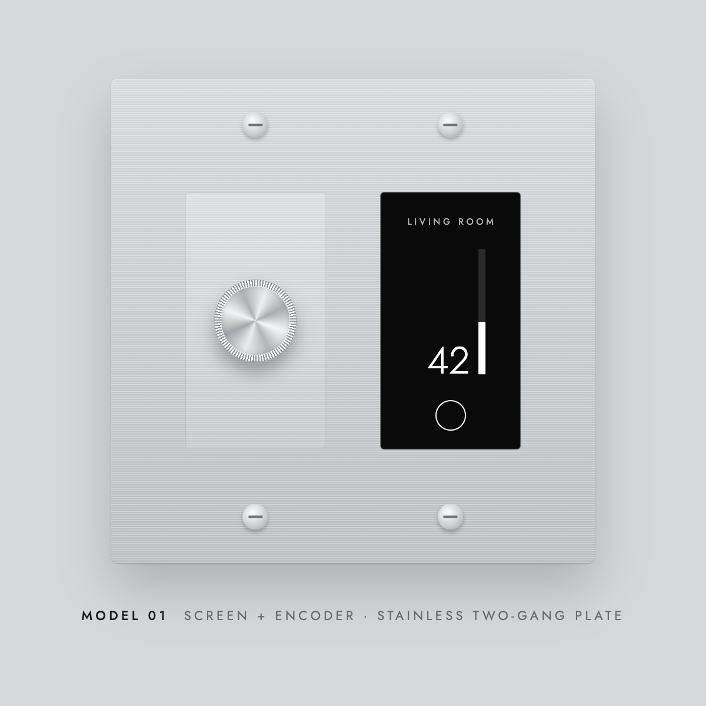
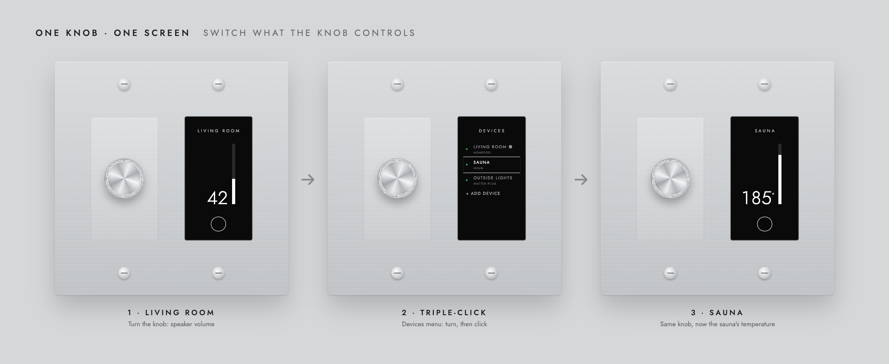
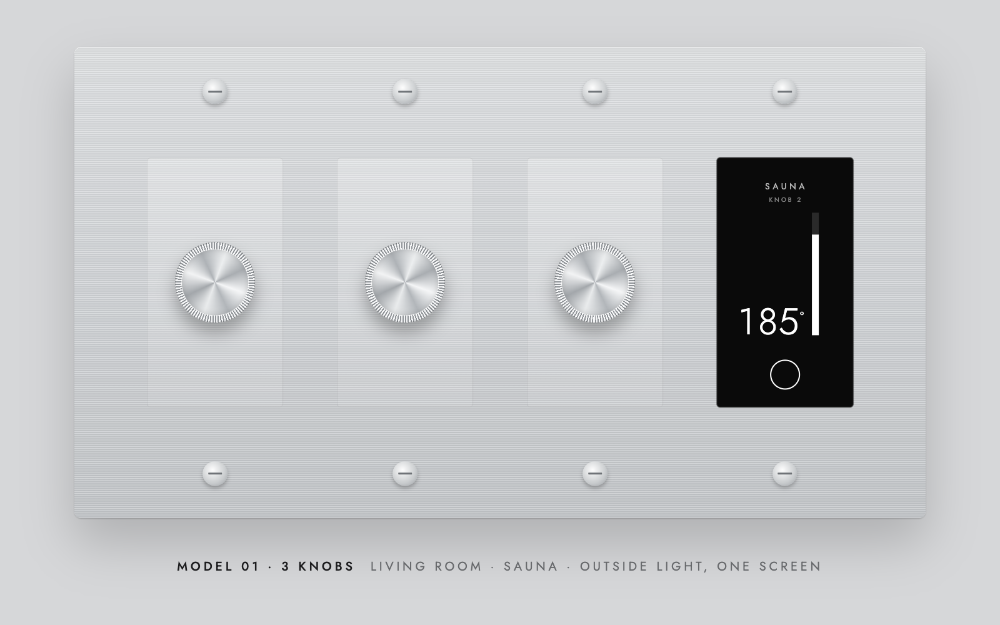
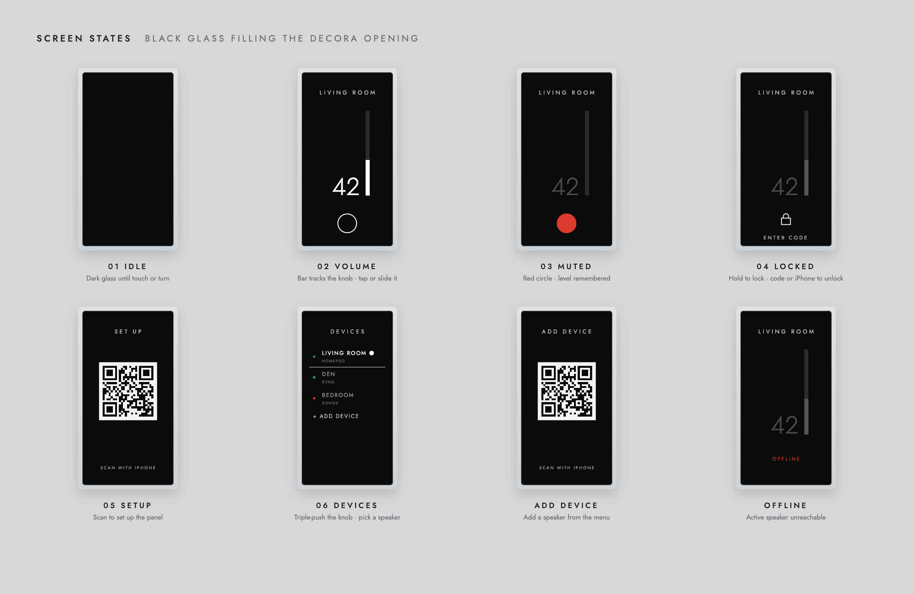
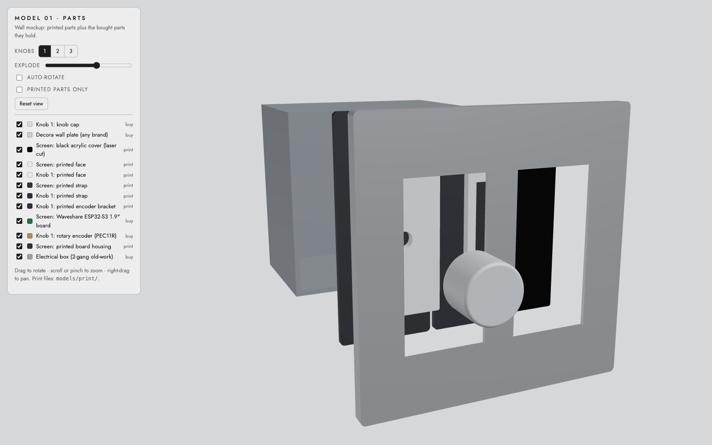

# airplay-manual-vol

A wall control for the whole house: a knob and a small black-glass screen that
fit under a standard Decora plate. Turn the knob and only the device on that
knob changes: one room's speaker while music keeps playing from your phone over
AirPlay, or the lights, the sauna or the grill. Up to three knobs share one
screen, and one panel can reach every device in the home.



AirPlay only lets the device that's playing change a speaker's volume. Most
speakers also have their own local control channel, and this project uses
that. There's no hub, no account and no app needed day to day.

This repo has everything: the research, working drivers, a live web prototype
of the panel, the ESP32 firmware (in progress) and the hardware build files.
It's MIT-licensed. If your speaker or device isn't supported, add a driver
([CONTRIBUTING.md](CONTRIBUTING.md)).

## Speaker support

Volume per speaker, from the wall, while anyone is AirPlaying to it.

| Category | Speaker | How | Setup | Tested |
|---|---|---|---|---|
| **Direct, local** | **Sonos** | UPnP on the speaker (port 1400) | None | ✅ By ear, Sonos P5 |
| | **HomePod / HomePod mini** | Apple's remote-control protocol over AirPlay | One-time pairing if the home has an AirPlay password | ✅ By ear, with and without a password |
| | **Syng Cell** | JSON-RPC over a secure WebSocket (port 8765) | None | ✅ By ear, a Cell pair |
| **Through a HomePod** | Other AirPlay speakers | The HomePod leads the group and passes the volume on | One-time HomePod pairing | ✅ Only while a HomePod leads the group |
| **All together** | **Master Volume** | Moves every speaker at once, keeping their balance, like the iPhone's volume | Appears with 2+ speakers | ✅ In the demo |

## Other device support

| Category | Device | How | Setup | Tested |
|---|---|---|---|---|
| **Lights and plugs** | **Matter plugs, switches, dimmers** (e.g. Tapo P400M, P430M) | Local Matter, as an extra controller next to Apple Home (Apple Home keeps working) | A pairing code from the Home app | Not yet on a real device |
| **Saunas** | **HUUM** (UKU Wi-Fi) | HUUM's cloud API: target temperature, start / stop, session time left, door check | HUUM app login | ✅ A real HUUM sauna: live status, start / stop, timer. One sauna per account for now ([help wanted](#help-wanted-two-huum-saunas)) |
| **Grills** | **Traeger** | Traeger's cloud (unofficial): grill and probe temperatures; changes the set temperature only while cooking, never starts or stops the grill | Traeger app login | Sign-in checked; not yet with a real grill |
| **Demo only** | Simulated lights, dimmer, speakers, sauna, grill | Built into the prototype | None | So you can try a whole-house panel without the hardware |

The details, including the dead ends, are in [docs/FINDINGS.md](docs/FINDINGS.md).

## Try the live prototype

The prototype is a web page that looks and behaves like the panel. A small
server on your computer does what the panel's chip will do: it talks to your
speakers directly. Your computer must be on the same network as the speakers,
with Python 3.11 or newer.

**From a clone of this repo:**

```sh
./run.sh            # then open http://127.0.0.1:8080/
```

**Or install the `wallvol` command** (works once the repo is published):

```sh
pipx install git+https://github.com/wipcomputer/airplay-manual-vol
wallvol             # then open http://127.0.0.1:8080/
```

Matter devices need Node.js (the server starts a small Matter controller;
`run.sh` installs it). Settings (devices, HomePod pairing keys, Matter fabric,
cloud logins) are kept in
`~/.wallvol/`, or in the repo folder when you use `run.sh`. They're private and
never committed.

### Set the panel up like a buyer would

A new panel shows **SET UP** and a code on its screen. Click the code, and an
iPhone opens beside the panel running the setup flow (it stands in for the iOS
App Clip):

1. **Wi-Fi:** the panel joins your network. This step is simulated.
2. **Choose a device:** a real scan of your network for Sonos, HomePod and
   Syng, plus Matter (pairing code), HUUM and Traeger (sign in), and the
   simulated devices behind **Show demo devices**.
3. **Room name**, plus the AirPlay password if it's a HomePod that has one. This
   pairs the panel with the HomePod for real, once.

Then the panel wakes up and the knob works.

**One panel can control everything in the house.** Triple-click a knob to
open the menu, then **Devices**: it lists every device set up in your home (green dot
= connected, red = offline). Turn the knob to move, click to switch, or pick
**+ Add device** to show a setup code and add another from your phone. Each
knob remembers the device you picked last.



*One knob and one screen, switched from the living room speaker to the sauna.*

**Up to three knobs, one screen.** Pick **Knobs: 1 · 2 · 3** under the panel
for a 2-, 3- or 4-gang plate. Each knob controls its own device, say the living
room speaker, the sauna and the outside lights, and the screen follows the knob
you touch, labelled KNOB 1, 2 or 3. On a setup code, click a knob to set up
that knob.



**Not just speakers.** The screen shows each device the right way: a
percentage for speakers and dimmers, a target temperature for a sauna or grill
(°F or °C), and ON / OFF for plugs and switches. For a sauna or grill the
screen shows the target and, under it, the actual temperature ("NOW 165°"). A
sauna starts and stops with a long press, like the HUUM app; while it runs a
round timer empties over the session with the time left under it.

**Panels sync.** Click **+ Add panel** above the plate to simulate a second
panel in another room. Devices set up on any panel appear in every panel's
Devices list, but each knob keeps its own device: the Living Room panel stays
on the living room until someone picks something else on it.

**The AirPlay password is asked for once.** It's one setting for your whole
Apple Home, so after the first HomePod, every other HomePod pairs with the saved
password automatically. If it stops working (say you changed it in the Home
app), setup asks again.

- **Factory reset this panel:** that panel forgets its own settings and shows
  the setup code. The home's devices stay on your other panels.
- **Start over as a new user** (or `wallvol reset`): erases every panel,
  device, login, password and pairing key, like a fresh install.

To do setup on your actual iPhone, start the server with `--lan`
(`./run.sh --lan` or `wallvol --lan`) and scan the code with the camera. The
code carries the server's per-launch key, so only the phone that scanned it can
use the panel's API; other devices on the network are refused. Turn `--lan` off
when you're done.

The **ESP32 log** under the panel shows what the chip would be doing at each
step: booting, provisioning, scanning, pairing, connecting, and every knob event
and volume command with its timing. Steps the computer can only pretend to do,
like Bluetooth, are marked `(sim)`.

### Using the panel

With a mouse standing in for your finger (a real panel: your finger and the
knob).

**Basics**

| Do this | It does |
|---|---|
| Click the knob, or touch the screen | Wakes the screen |
| Drag the knob in a circle (or scroll on it) | Changes the level, 2% per detent |
| Tap or slide on the bar on the screen | Sets the level directly |
| Double-click the knob, or click the circle on the screen | Mutes and unmutes (the level is remembered); ON / OFF for a plug |
| Touch a knob (with several) | The screen follows it and says KNOB 1, 2 or 3 |
| Click a knob on a setup code | The code switches to that knob |
| Keyboard: <kbd>↑</kbd> <kbd>↓</kbd>, <kbd>M</kbd>, hold <kbd>L</kbd> | Turn, mute, lock |

**Menu and settings** (navigation like an iPod)

| Do this | It does |
|---|---|
| Triple-click a knob, from anywhere | The top **MENU**: **Devices** and **Settings** |
| In a menu: one click · two clicks · three clicks | Pick · **back** one level (the iPod's MENU button) · the top MENU |
| **Devices** | Every device in the home: switch this knob's device, **Master Volume** (with 2+ speakers), or **+ Add device** (shows a setup code) |
| **Settings** | Brightness, Dim Brightness (how bright the screen stays asleep, 5 % by default), Temperature °F / °C, Name (typed on the iPhone), Auto Update (installs new firmware on its own), Lock panel. Turn to set a level, push or tap to save; you land back on Settings |
| Tap the device's name | Every device of that kind, e.g. all saunas |
| Double-tap a temperature | °F / °C for the whole home |

Every list ends with ‹ Back or Exit, and scrolls by swiping.

**Sauna**

| Do this | It does |
|---|---|
| Turn the knob | Sets the target. While it's off, only the target changes; while it's on, the session (and its timer) carries on |
| Hold the round timer, or the knob | After 1 s a white ring fills for 1.5 s, then the sauna starts or stops. A short tap does nothing |

**Lock**

| Do this | It does |
|---|---|
| Press and hold the knob (not on a sauna) | After 3 s a red ring fills; when it's full (about 6 s) the panel locks |
| First lock | SET CODE, then CONFIRM CODE: choose the 4-digit unlock code on the panel itself |
| Touch or turn a locked panel | ENTER CODE (turn and push the knob, or tap the keys). 5 wrong tries = 30 s wait |
| **Tap iPhone (NFC)** (while locked) | Simulates tapping your iPhone on the glass: Face ID, then a signed unlock. Only iPhones that set up the panel can unlock it |

The screen dims to 5 % after a few seconds (Settings → Dim Brightness), and it
picks up changes made elsewhere, for example the volume from your phone.

**See it at real size:** use − / + above the panel, or **Actual size…**: hold
a credit card against your screen and adjust until the outline matches. The
panel is then shown at its true physical size.

### Using an AI assistant

Open this folder with Claude Code (or another coding agent) and say:

> Run the panel prototype.

[AGENTS.md](AGENTS.md) tells the assistant how to install it, start it and walk
you through setup.

### Command line

```
wallvol                 start the prototype (add --lan for phone setup, --port to change 8080)
wallvol discover        scan for speakers and save them
wallvol reset           start over: erase all panels, speakers, passwords and keys
```

## The product

**Model 01:** one to three encoder knobs, and a screen gang with a 1.9"
display, the ESP32-S3 and the power supply behind black glass (2-, 3- or 4-gang
Decora). Each knob controls its own device; panels in the same home sync.



### Build one



- [hardware/PARTS.md](hardware/PARTS.md) and [hardware/BUY.md](hardware/BUY.md): what to buy and where.
- **3D viewer:** run the demo and open <http://127.0.0.1:8080/hardware/viewer.html> (rotate, zoom, explode, 1-3 knobs).
- **Print files:** `hardware/models/print/` (STL to print, STEP to edit, DXF for the acrylic), made by `hardware/cad/model.py`.
- **Firmware:** [firmware/README.md](firmware/README.md).
- **Apple Watch:** a sauna app stub, Digital Crown = target temperature: [apps/watch-sauna/](apps/watch-sauna/README.md) (on hold).

- [docs/PRODUCT_PLAN.md](docs/PRODUCT_PLAN.md): what it is, who it's for, the build phases and the risks
- [docs/HANDOFF.md](docs/HANDOFF.md): the original engineering brief
- [docs/UX.md](docs/UX.md): every control, screen state and setup step, as a tree
- [docs/APPLE.md](docs/APPLE.md): what we need from Apple (Developer Program, NFC, App Clip) and how saved passwords are shared
- [docs/STATUS.md](docs/STATUS.md): what's done and what's next
- [docs/design/](docs/design/): the original mockups (front, screen states, three-quarter view, PDF)
- `docs/images/` is rendered from the prototype's own styling: run `python tools/render_images.py` after changing the panel's look

## Repo layout

```
wallvol/            the reference implementation (the `wallvol` command)
  drivers/          one driver per brand: sonos, homepod, syng, matter, huum,
                    traeger, sim (start here to add a brand or device)
  server.py         prototype server: plays the ESP32's role, logs like it
  store.py          the home: panels, knobs, devices, settings (config.json)
  discover.py       finds speakers on the network
  pairing.py        one-time HomePod pairing with the AirPlay password
  matter/           local Matter controller (Node + matter.js), started by the server
  web/index.html    the panel, drawn in the browser
  web/setup.html    the phone setup flow (stands in for the App Clip)
  web/unlock.html   the phone's NFC unlock
firmware/           ESP-IDF project for the ESP32-S3 panel (builds; catching up with the demo)
hardware/           parts, where to buy, CadQuery model, print files, 3D viewer
apps/watch-sauna/   watchOS sauna app stub (on hold)
spike/              the original one-off test scripts from the research
tests/              e2e_test.py (Playwright click-through), test_huum.py
docs/               findings, product plan, status, UX map, dev log, design
tools/              render_images.py: regenerates the README images
run.sh              one-command start
```

The scripts in `spike/` also work on their own from the command line, for
example `spike/sonos_volume.py HOST set 20` or `spike/syng_volume.py HOST 20`.
Each one's usage is at the top of the file.

## Tests

An end-to-end test clicks through the demo in a real (headless) browser, 30
checks: setup and every add-device option, wrong HUUM / Traeger logins, Matter
code validation, a demo device end to end, the knob, SET / CONFIRM CODE, wrong
and right codes, NFC unlock, Master Volume, sauna start / stop (timer ring and
knob hold), °F / °C, the sauna list, Settings (Brightness, Dim Brightness,
Name, Auto Update), menu navigation (back, top, exit), dimming and factory
reset. It runs its own server on port 8099 with throwaway settings, so your
demo isn't touched. `tests/test_huum.py` checks the HUUM driver against a real
status reply.

```sh
.venv/bin/pip install -r requirements-dev.txt && .venv/bin/python -m playwright install chromium
.venv/bin/python tests/e2e_test.py          # --headed to watch it
.venv/bin/python tests/test_huum.py
```

## Help wanted: two HUUM saunas

**Have you got the HUUM API working with more than one sauna?** We'd love a
contribution. The HUUM driver uses the API the community has documented
(`api.huum.eu/action/home/status`, `start`, `stop`, HTTP Basic login). That API
acts on "the sauna on this account": it has no sauna ID, no sauna name and no
list of saunas. HUUM's newer app shows each sauna's name and adds another with
the **Sauna ID + CODE** from the sticker on the main module, so it must use an
API that isn't published yet.

What we'd need, from anyone who has two saunas (or has captured the app's
traffic, e.g. with Proxyman):

- how the app lists the saunas on an account, with their names;
- how it picks which sauna `status` / `start` / `stop` act on;
- how "Add sauna" sends the Sauna ID and CODE.

Until then, "+ Add sauna" on the panel is turned off (it's commented out in
`wallvol/web/index.html`), and the sauna's name is set in Settings → Name.
Open an issue or a pull request; see [CONTRIBUTING.md](CONTRIBUTING.md) for
how drivers fit together. Please never post your login or the CODE from your
sticker.

## Caveats

- Unofficial. HomePod and Syng control use protocols that aren't public, and
  the HUUM and Traeger clouds aren't public APIs either; an update could change
  any of them. That's one reason for over-the-air updates (Settings → Auto
  Update).
- The HomePod driver patches pyatv internals (pinned to 0.18.0).
- Syng's current volume can't be read yet, so the panel shows the last level it
  set.
- Pairing keys in `credentials/`, the Matter fabric in `matter/` and the
  logins in `config.json` are private and gitignored. Keep them that way.
- The demo server drives real devices, so its API takes requests only from
  its own pages: a host-name allowlist, JSON with a matching origin, and a
  per-launch token (see [SECURITY.md](SECURITY.md)). Scripts on your computer
  can read the token from `credentials/api-token`.
  Repeated failed pairings lock a HomePod out for a growing time.

## License

[MIT](LICENSE) © 2026 WIP Computer, Inc.
