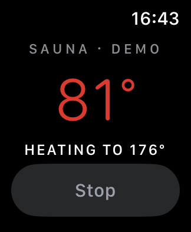

# Sauna for Apple Watch (stub)

A watchOS app for the HUUM sauna: the **Digital Crown sets the target
temperature** (the same idea as the wall knob), the big number is the sauna's
current temperature (red while heating), and one button starts or stops it.



- Talks to HUUM's cloud directly (the same API as `wallvol/drivers/huum.py`),
  so it works away from home.
- Won't start while the sauna door is open, like the HUUM app.
- The HUUM login is stored in the watch's Keychain. In this stub you type it on
  the watch; the real app would receive it from the iPhone app.
- **Demo sauna:** "Try the demo sauna" on the sign-in screen, or launch with
  `-demo` (add `-heat` to start heating). It heats about 1 °C every 2 s.

Status: **on hold** (Parker, 2026-10-13). Builds and runs in the watchOS
simulator (demo). Not yet tried against the real sauna or on a real watch
(needs signing with the WIP Computer developer team in Xcode).

Known gaps, found on the wall panel since this stub was written:

- HUUM sends temperatures as strings ("90"); `SaunaService.swift` reads them as
  numbers, so the real sauna's readings would come back empty.
- `start` with only a target begins a new 3 h session. Changing the target
  while heating must also send the running `startDate` / `endDate` (as
  `wallvol/drivers/huum.py` now does), or the session timer resets.

## Build

```sh
brew install xcodegen
cd apps/watch-sauna
xcodegen generate                 # creates Sauna.xcodeproj (gitignored)
open Sauna.xcodeproj              # pick your team under Signing, run on a watch or simulator
```

Command line (simulator, no signing):

```sh
xcodebuild -project Sauna.xcodeproj -scheme Sauna -sdk watchsimulator \
  -destination 'generic/platform=watchOS Simulator' -derivedDataPath build CODE_SIGNING_ALLOWED=NO build
```

## Files

```
project.yml              XcodeGen project (watch-only app, watchOS 10+)
Sources/SaunaApp.swift   app entry and the model (polling, start/stop, sign-in, demo)
Sources/SaunaView.swift  the screen: crown target, current temperature, start/stop; sign-in
Sources/SaunaService.swift  SaunaService protocol, HuumService (HUUM cloud), DemoSauna
Sources/Keychain.swift   stores the HUUM login
```
