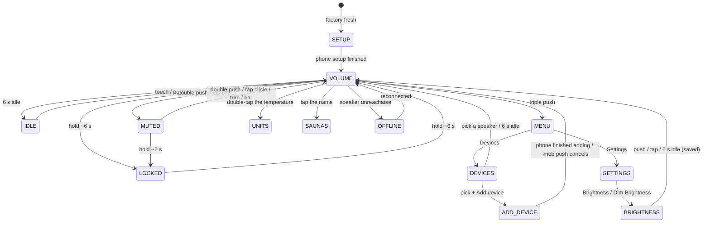
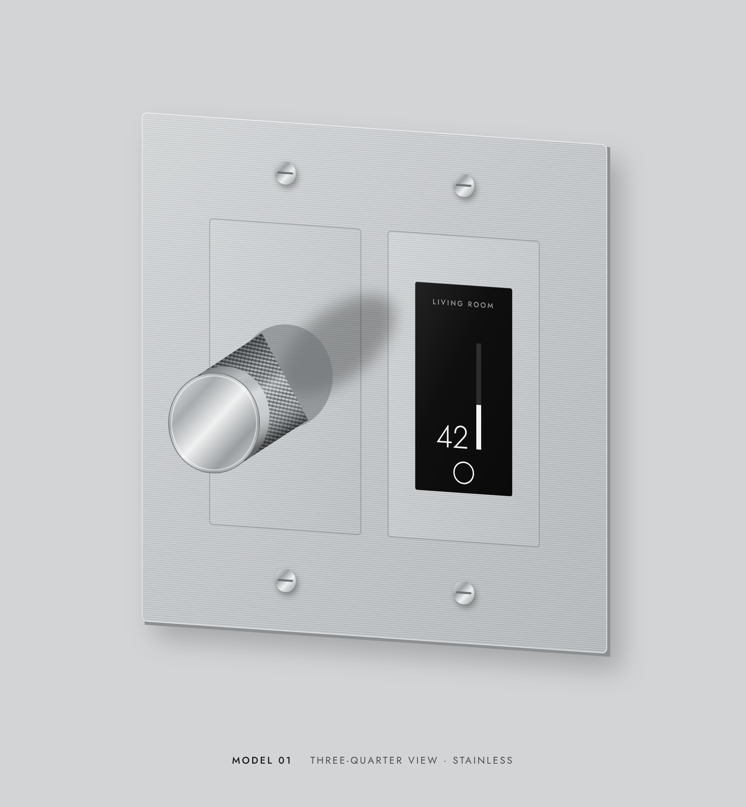

# UI and UX map

Everything a person can see or do with the panel and its setup, as a tree. This
is the behaviour spec: the web prototype (`wallvol/web/`) implements it today,
and the ESP32 firmware and iOS app should follow it.


## 1. The panel (Model 01)

```
Panel (2-, 3- or 4-gang Decora: 1 to 3 knobs plus one screen, screen on the right)
├── Each knob gang: knob (endless encoder with push switch), controlling its own device
│   ├── Touch / turn / push .......... puts this knob in focus: the screen shows its device
│   │                                  ("KNOB n" under the name, when there are several)
│   ├── Push on a SET UP / ADD DEVICE code .. the code switches to this knob
│   │                                  (pushing the knob already shown on ADD DEVICE cancels)
│   └── A knob with no device yet .... touching it opens its Devices menu to pick one
│   ├── Turn ......................... level up/down, 2% per detent (a temperature: its range)
│   │                                  (in a menu: move the highlight; on BRIGHTNESS: 5% steps)
│   ├── Push once .................... wake the screen
│   │                                  (in a menu: pick the highlighted item)
│   │                                  (on the Add Device code: cancel)
│   ├── Push twice (within 350 ms) ... mute / unmute (level remembered)
│   ├── Push three times ............. the top MENU, from anywhere (menus, settings, a level
│   │                                  being set): Devices (this knob's device list) and Settings
│   │                                  (Brightness, Dim Brightness, Temperature °F/°C, Name,
│   │                                  Auto Update, Lock panel)
│   ├── In a menu or setting: push once = pick / save · push twice = back one level (like the
│   │                                  iPod's MENU button; from MENU: the main screen) · three = MENU.
│   │                                  A single push waits the 350 ms click gap to be sure it's alone.
│   │                                  Every list ends with ‹ BACK (one level up) or EXIT.
│   │                                  Pages opened from SETTINGS always return to SETTINGS
│   │                                  (save, pick, idle, EXIT on the code pad).
│   ├── Hold, on a sauna ............. same as holding the timer ring: start / stop (no red
│   │                                  lock ring; lock from Settings → Lock panel)
│   └── Hold ......................... after 3 s a red ring starts filling;
│                                      when full (~6 s) the whole panel locks
│                                      (first lock: SET CODE then CONFIRM CODE on the panel;
│                                       locked: touch / turn / push opens ENTER CODE)
│                                      (release early: nothing happens)
└── Screen gang: screen (black glass filling the whole Decora opening, touch)
    ├── Touch anywhere ............... wake the screen
    ├── Tap or slide the volume bar .. set the focused knob's level directly (2% steps)
    ├── Tap the mute circle .......... mute / unmute the focused knob's device
    ├── Tap the device's name ........ list every device of that kind (e.g. SAUNAS) + "+ ADD SAUNA"
    │                                  (+ ADD SAUNA is commented out for now: one sauna, and HUUM's
    │                                  multi-sauna API isn't known; see README → Help wanted)
    ├── Double-tap a temperature ..... UNITS screen: °F / °C for the whole home (tap, or turn + push)
    ├── Sauna: hold the timer ring ... nothing for 1 s (so quick clicks stay clicks), then a white
    │                                  ring fills for 1.5 s and the sauna starts or stops;
    │                                  a short tap does nothing
    ├── Swipe a menu list ............ scroll it (the knob keeps the highlight in view)
    ├── Tap a menu item .............. pick it
    └── Tap a setup code ............. open the phone setup (prototype: the phone frame)
```

How each kind of device is shown and stepped (the driver says which):

```
Device kinds
├── level ........ speakers, dimmers: 0-100 %, 2% per detent, mute remembers the level
├── temperature .. sauna, grill: a target across the device's range, in °F or °C (home setting)
│                  (e.g. sauna 110-195 °F, grill 165-500 °F); grill: mute = off, level remembered
│                  sauna ("startable"): the knob only sets the target while it's off; long press
│                  on the timer ring starts / stops it; double push and mute do nothing
└── switch ....... plugs, lights: ON / OFF; turn right = on, left = off;
                   double push or mute circle toggles; no bar or mute circle shown
```

**Unlock with an iPhone** (built in the demo): tap the iPhone on a locked
panel's glass (an NFC tag behind it opens the app), Face ID, and the app sends
an unlock signed with the key the panel gave it at setup. Only iPhones that set
the panel up (or added a device to it) can unlock it.

Rules that apply everywhere:

- A touch on dimmed glass only wakes the screen. It never changes anything.
- A locked panel ignores turns, taps and mute. It unlocks with its 4-digit code
  (ENTER CODE, by knob or touch) or a paired iPhone, not with a hold.
- Turning the knob or setting a level unmutes.
- The screen dims after 6 s without input, to the Dim Brightness level (5 % by
  default, Settings → Dim Brightness; 0 % = dark). Setup codes stay lit.
- Volume changes made elsewhere (the phone's AirPlay slider, the speaker's own
  buttons) show up on the panel within about 1.5 s. Syng is the exception
  for now: its volume can't be read yet.

## 2. Screen states


```
Screen
├── 01 IDLE ........ dimmed to Dim Brightness (5 % by default)
├── 02 VOLUME ...... name · "KNOB n" (several knobs) · level, temperature or ON/OFF ·
│                    for a sauna/grill a live reading under it: "NOW 165°" · "PROBE 140°" ·
│                    vertical bar · mute circle (outline)
├── SAUNA OFF ...... target dimmed · "OFF · NOW 70°" · empty ring with ⏻ · "HOLD TO START"
├── SAUNA ON ....... target · "NOW 165°" · orange ring, full at the start, emptying as the
│                    session runs, steam icon · time left under it ("2:56:44")
│                    Layout: the bar stays where it is on every screen; the target sits at the
│                    bar's middle with its reading under it; ring + time are one unit centered
│                    in the space below the bar. Changing the target keeps the session (HUUM's
│                    start is sent with the running session's startDate / endDate).
├── 03 MUTED ....... number dimmed · bar empty · mute circle solid red
├── 04 LOCKED ...... number and bar dimmed · lock icon · "ENTER CODE" / "OR TAP IPHONE"
├── SET / CONFIRM CODE  first lock only: choose 4 digits on the panel, then again; mismatch →
│                    DIDN'T MATCH and start over; EXIT cancels (stays unlocked)
├── ENTER CODE ..... 4 dots · keypad 1-9, DEL, 0, EXIT · turn = move highlight, push = press,
│                    or tap; wrong → WRONG CODE; 5 wrong → WAIT 30 S; closes after 10 s idle
├── 05 SETUP ....... "SET UP" · "KNOB n" (several knobs) · setup code · "SCAN WITH IPHONE"
│   └── ADD DEVICE . same screen, titled "ADD DEVICE" (from a Devices menu)
├── 06 DEVICES ..... "DEVICES" (or "KNOB n") · list of the home's devices; with 2+ speakers,
│                    MASTER VOLUME right after them (all speakers together, balance kept)
│                    (green dot = connected, red = offline, ● = active)
│                    · "+ ADD DEVICE" last
├── MENU ........... (triple push) DEVICES · SETTINGS · EXIT
├── SETTINGS ....... BRIGHTNESS (awake, 10-100 %) · DIM BRIGHTNESS (asleep, 0-100 %, default 5 %)
│                    · TEMPERATURE (°F / °C) · NAME (opens a rename screen on the iPhone)
│                    · AUTO UPDATE (On: installs new firmware releases on
│                    its own; Off: only from the app) · LOCK PANEL · ‹ BACK
├── BRIGHTNESS ..... title · big "80%" · bar · "PUSH OR TAP TO SAVE"; turn = 5 % steps,
│                    previewed live; saved per panel; 6 s idle also saves
├── UNITS .......... °F · °C (● = current); home-wide
├── SAUNAS ......... (tap the name) every device of that kind · "+ ADD SAUNA"
└── OFFLINE ........ number and bar dimmed · "OFFLINE" in red
                     (active speaker unreachable; not in the original mockups)
```

How the panel moves between them:



## 3. Phone setup (the App Clip; prototype: `/setup`)

```
Setup on iPhone
├── New panel (scan the SET UP code)
│   ├── 1. "Set up your panel" ........ found nearby over Bluetooth (simulated)
│   ├── 2. Wi-Fi ...................... panel joins this iPhone's network (simulated)
│   ├── 3. Choose a device ............ live network scan: Sonos, HomePod, Syng, plus:
│   │   ├── Show demo devices ......... simulated light, dimmer, sauna, grill, speakers,
│   │   │                               labeled "(demo)"; hidden until asked
│   │   ├── Add a Matter device ....... pairing code from the Home app + name; every
│   │   │                               outlet/light becomes its own device
│   │   ├── Connect a HUUM sauna ...... HUUM app email + password + name ("e.g. Crane Sauna":
│   │   │                               the name from the HUUM app; the API doesn't give it)
│   │   └── Connect a Traeger grill ... Traeger app email + password + name
│   │   └── badges: "In your home" (already set up) · "Password" (HomePod, none saved)
│   ├── 4. Name the room
│   │   └── AirPlay password .......... only for a HomePod with a password and none saved
│   │       ├── first time: typed once, saved for the whole home
│   │       ├── later HomePods: "Uses your home's saved AirPlay password"
│   │       └── saved one rejected: asks again, saves the new one
│   └── 5. "<Room> is ready" .......... panel wakes on that speaker
└── Add a device (scan the ADD DEVICE code)
    └── same as above from step 3, without Wi-Fi; the new device goes on
        the knob whose menu it was added from
└── Rename (Settings → Name on the panel)
    └── the current name, Save; every panel shows the new name
```

Errors shown in setup: no speakers found (scan again), wrong AirPlay password,
HomePod refusing pairing after earlier failures (with the wait time), Speaker &
TV Access not set to "Anyone on the Same Network", HomePod unreachable.

## 4. A home with several panels

```
Home
├── Household (synced to every panel)
│   ├── devices that have been set up (name, address, pairing key or login)
│   ├── the AirPlay password (asked once)
│   └── °F or °C
└── Each panel
    ├── its knobs (1-3), each with its own device (starts as the one it was set up with)
    ├── each knob's Devices menu lists every household device
    ├── its lock and 4-digit code, and the iPhones that can unlock it
    └── Brightness, Dim Brightness, Auto Update
```

- Adding a device on any panel adds it to every panel's menu. No knob's
  device changes because of another panel.
- Factory reset of one panel: it forgets its own settings and shows SET UP
  again. The household's devices stay.

## 5. Prototype-only controls (the web page around the panel)

```
Web prototype
├── Panel tabs ..................... one tab per simulated panel, labelled with its active room
│   └── + Add panel ................ a new factory-fresh panel
├── Tap iPhone (NFC) ................ while locked: opens the phone's unlock screen (Face ID, signed unlock)
├── Knobs 1 · 2 · 3 ................. hardware configuration: 2-, 3- or 4-gang plate
├── Plate screws (easter egg) ........ click: the screw turns 60° counterclockwise (unscrewing);
│                                    the third click spins it out and opens the 3D parts viewer
│                                    (/hardware/viewer.html)
├── Mouse on a knob ................. drag in a circle, or the scroll wheel (hover-to-turn was tried
│                                    and dropped)
├── Size ........................... − / + (5% steps), Reset (1.75x the original size)
│   └── Actual size… ............... shows a credit-card outline; match it with − / +
│                                    and the panel is at real size (saved per browser)
├── Phone frame .................... an iPhone 16 Pro at true scale (same px/mm as the panel); the page
│                                    inside renders at 402 pt and is scaled; opens from a setup code or
│                                    Tap iPhone; × closes it; ?phone=setup / ?phone=unlock opens it on load
├── Status ......................... connection, active speaker, last command time (ms)
├── Buttons
│   ├── Factory reset this panel
│   ├── Remove this panel
│   └── Start over as a new user ... erases every panel, speaker, password and key
├── How to use the panel .......... instructions (show / hide, remembered)
├── ESP32 log (show / hide) ....... what the selected panel's chip would be doing;
│                                    "(sim)" marks simulated steps
└── Keyboard ....................... ↑ ↓ turn · 1 2 3 focus a knob · M mute · hold L lock
```

Images: `images/` is rendered from the prototype (`python tools/render_images.py`);
`design/` holds the original mockups, including this three-quarter view, which
still shows the earlier framed screen:


